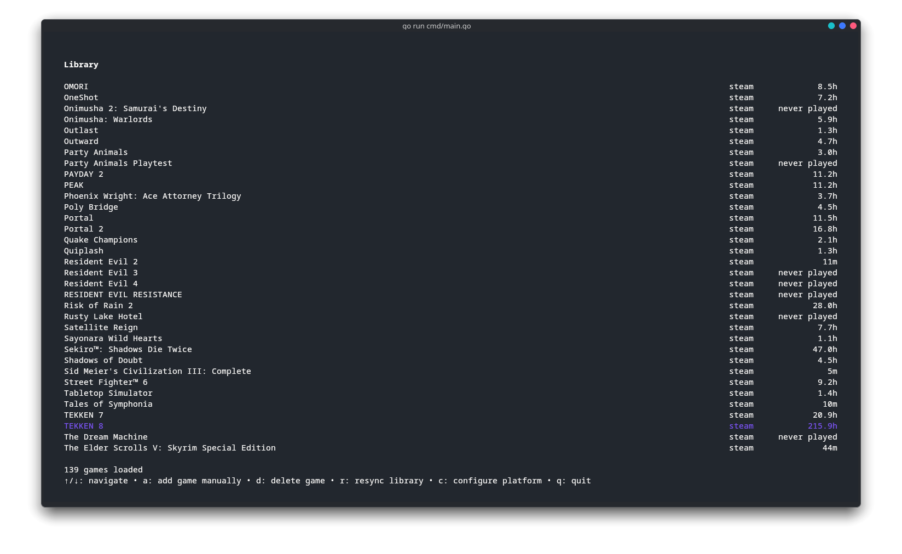

# penpenbox

A Linux-focused game library manager for your terminal!




## Features
- Sync your games from different platforms (currently only Steam).
- Manually add games from other platforms or physical editions.
- Your data stays on your machine, in a local SQLite database.

## Installation

### From source

Requires [Go](https://go.dev/dl/) 1.26.3 or newer.

```bash
git clone https://github.com/nunessdev/penpenbox.git
cd penpenbox
go build -o penpenbox ./cmd
./penpenbox
```

## Getting a Steam API key

To get your own API Key:
- Go to https://steamcommunity.com/dev/apikey and sign in.
- Enter any domain name (e.g. `localhost`) and copy the key it gives you.

You also need your 64-bit Steam ID, a 17-digit number:
- If your profile URL looks like `steamcommunity.com/profiles/<number>`, that number is your ID.
- If it uses a custom name (`steamcommunity.com/id/<name>`), paste your profile link into [steamid.io](https://steamid.io) and copy the `steamID64` value.

Make sure your profile's **Game details** are set to **Public** (Profile → Edit Profile → Privacy Settings), otherwise no games will be found.

## Key bindings

### Library

| Key | Action |
| --- | ------ |
| `↑` / `↓` | Navigation |
| `a` | Add a game manually |
| `d` | Delete the selected game (press twice to confirm) |
| `r` | Resync library from Steam |
| `c` | Configure platform |
| `q` | Quit |

### Platform select

| Key | Action |
| --- | ------ |
| `↑` / `↓` | Move selection |
| `enter` | Configure the selected platform |
| `esc` | Back to library |
| `q` | Quit |

### Steam setup / Add game

| Key | Action |
| --- | ------ |
| `↑` / `↓` | Switch field |
| `enter` | Submit |
| `esc` | Back |

## Where files are stored

- Config: `~/.config/penpenbox/config.json`
- Database: `~/.local/share/penpenbox/penpenbox.db`

## License
[GPL-3.0](LICENSE)
